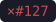
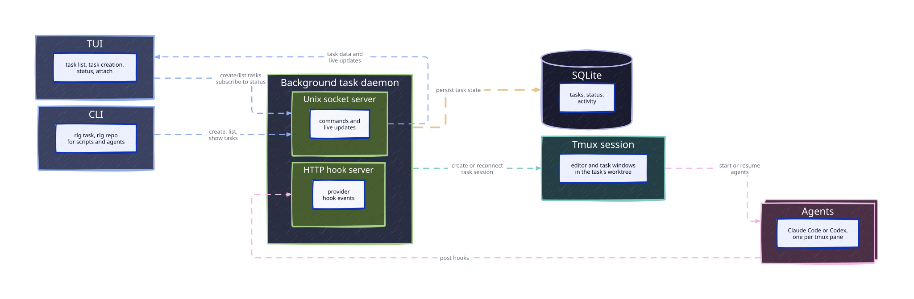

# How Rig Works

Usage reference and the mechanics behind the [README](../README.md).
Domain terms are defined in [CONTEXT.md](../CONTEXT.md).

## Terminal UI

Press `n`, describe the task, and press `enter`. Rig names the task, creates its
branch and worktree, and starts your default provider in a new tmux session.
The prompt is pasted into the agent but not sent. If the prompt names an issue
or ticket, the provider looks it up with whatever read-only access you have
given it (`gh`, or a Jira, Linear, YouTrack or Shortcut MCP server), so only
give it tools you trust with your tickets.

To add another agent to a task, split a pane in its tmux session and run
`claude` or `codex` there. Rig shows it as a sub-row of the task once you send
it a prompt. See [Running More Agents](#running-more-agents) for details.

To open Rig as a popup over whatever you're doing, bind it in `~/.tmux.conf`:

```tmux
bind R display-popup -E -w 80% -h 70% rig
```

| Key | Action |
|-----|--------|
| `n` | Create a task |
| `tab` | Switch provider while writing the prompt |
| `ctrl+o` / `ctrl+r` | Pick the model / reasoning level while writing the prompt |
| `ctrl+n` | Pick the repository while writing the prompt |
| `ctrl+p` | Create the task from a GitHub pull request |
| `j` / `k` | Move between tasks and their agents |
| `enter` | Jump to the agent that most needs you, or to the selected agent |
| `m` | Jump to the tmux session of the task's main repository |
| `c` | Copy the task's prompt to the clipboard (needs OSC 52; in tmux, `set-clipboard on`) |
| `R` | Retry a failed task creation |
| `x` | Remove the task's tmux session and worktree (its branch stays), or on an agent, close only that agent |
| `q` | Quit |

### Reading the task list

Each task is one row, led by its status symbol:

```text
◆ Fix login redirect                ✓●#127+  claude   45%  ↻2   7h 05m
```

After the status come the task's name (with `↳` when another task created it,
or `↪` when that task is in another repository), its pull requests, and then,
muted: the provider, how full the context window is, how many times it has
compacted, and the task's age. A task with several
agents gets a sub-row per agent. A row is highlighted until you have looked at
the agent that needs you. The panel under the list describes the selected row
in words.

| Status | Meaning |
|:------:|---------|
|  | Needs input: the agent ended its turn, or asks for your approval or an answer |
|  | Needs input, while background work the turn started still runs |
|  | Working |
|  | Starting |
|  | Stopped: no agent is running |
|  | No agent has run yet |
|  | Being created |
|  | Creation failed; `R` retries it |
|  | Being removed |

| Pull requests | Meaning |
|:-------------:|---------|
|  | Open |
|  | Draft |
|  | Merged |
|  | Closed |
|  | Earlier pull requests come first, as symbols; `…` in front means older ones are left out |
|  | The branch has work no pull request contains yet |

## Per-repo Setup

To copy files into each new worktree and run a setup script there, add a
`.rig.yaml` to the repository root:

```yaml
seed:
  copy:
    - .env
    - local/
  setup_script: scripts/worktree-setup.sh
```

Paths must be repo-relative: absolute paths, `..` and globs are rejected.
Symlinks inside copied directories are followed only when they stay inside the
repository.

## Architecture

Rig is split between a foreground terminal UI and a background task daemon. The
daemon owns task creation, local state, provider hooks, and live update streams.



| Component | Role |
|-----------|------|
| **TUI** | The foreground interface for creating tasks, browsing task state, and attaching to running work. |
| **CLI** | The non-interactive `rig task` and `rig repo` commands for scripts and agents. Like the TUI, they talk to the daemon over the Unix socket. |
| **Background task daemon** | A long-lived `rig` process that creates tasks, starts or resumes providers, records status, and serves updates back to the TUI. |
| **Unix socket server** | The local control channel between the daemon and the TUI or CLI. It carries commands such as creating tasks and streams live task updates back to the TUI. |
| **HTTP hook server** | A loopback-only endpoint used by provider hooks to report session, prompt, tool, and stop events back to Rig. Routes exist for every supported provider. |
| **SQLite** | The local task database. It stores task records, agent sessions with their latest status and the conversation Reconnect resumes, activity snippets, and token usage. |
| **Agents** | The Claude Code or Codex processes running in a task's tmux panes, in its isolated worktree. Rig starts the first one with the task's provider; you can add more in other panes. Each sends hook events back to the daemon. |

When you launch `rig`, the foreground process ensures the task daemon is running
and then opens the TUI. The TUI talks to the daemon over a local Unix socket
instead of doing task orchestration itself.

When you create a task, the daemon prepares the isolated workspace, starts the
task's provider, records the task in SQLite, and streams status updates back to
the TUI. Provider hook events are posted to the daemon's local HTTP hook
server, which updates the agent session each event came from in SQLite and any
active TUI subscriptions.

This split keeps the terminal UI responsive while task setup, provider
sessions, and status collection continue in the background.

The TUI and daemon must be the same build: `rig` detects a version mismatch,
stops the old daemon, and spawns a new one. Manage the daemon directly with:

```bash
rig daemon status
rig daemon start
rig daemon stop
rig daemon restart
```

## Providers

Rig supports two providers: **Codex** and **Claude Code**. A provider Rig knows
how to integrate with is a *supported* provider; a provider you have enabled is
a *configured* provider. Each task has exactly one *active* provider at a time,
and new tasks start with your *default* provider.

If a provider's executable is not on your `PATH`, point Rig at it with
`RIG_CODEX_BINARY` or `RIG_CLAUDE_BINARY`.

Provider setup is mandatory: the first time you launch `rig` (or whenever your
provider config is missing or invalid) the TUI opens the setup screen before
normal task use. Setup detects which supported providers work on your machine
using the same checks task creation depends on, installs or repairs the hook
forwarding each provider needs, and requires you to enable at least one
provider and choose a default. It also installs the [Rig skill](#rig-skill) of
each provider you enable. Rerunning `rig setup` edits your existing choices
incrementally.

After the providers, setup offers an optional step for your repo directories:
parent directories, such as `~/code`, whose git repositories Rig lists so that
agents can find a repository by name (see [Command Line](#command-line)). When
you have none yet, it suggests the parent directory of the repository you run
setup from.

Provider setup and repo directories are stored in user-level config at
`~/.config/rig/config.json` (override with `RIG_USER_CONFIG_PATH`), never in
the task database, and repo-level default provider configuration is not
supported. The same file keeps each provider's launch default: the model and
reasoning level you last chose when creating a task with that provider, which
the next task starts from.

`RIG_PROVIDER` overrides the default provider for a single run. It must name a
configured provider; it cannot bypass setup:

```bash
RIG_PROVIDER=claude rig
```

`rig doctor` validates every configured provider. Supported providers you have
not configured are ignored, so a missing `claude` binary never fails doctor
unless you enabled Claude.

When a prompt asks to work on an issue or ticket, the provider looks it up with
whatever read-only access you've given it (`gh`, a Jira, YouTrack, Linear or
Shortcut MCP server) and names the task after it, such as `GH #18 Fix the
broken thing`. If the lookup fails, the ticket reference alone names the task.
Claude looks tickets up in auto permission mode with its file edit tools
denied, and Codex in its read-only sandbox. Neither stops network or MCP tool
calls.

## Provider Hooks

Rig uses provider hooks to capture live task status, recent activity, provider
session metadata, transcript paths, and token usage.

### Codex

Codex hooks must be enabled in `~/.codex/config.toml` (`[features] hooks =
true`). Rig installs and updates its own Codex hook forwarding entries
automatically (in `~/.codex/hooks.json`) during provider setup, when its daemon
starts, and when it starts task sessions. The forwarding hooks post local Codex
events to Rig's background daemon; other Codex hooks and plugins can remain
enabled. Codex keeps a trust record for each hook entry, so when a Rig update
adds or changes a forwarding entry (for example `SubagentStart`, or
`SessionEnd` and the `clear` start source of `SessionStart`), Codex asks you
once to trust it after Rig next rewrites the entries.

Rig starts and resumes Codex with `--no-daemon`, so each task's Codex runs its
own session instead of joining Codex's shared background server. Codex runs
hooks in the process that owns the session, and only a session running in the
task's tmux pane reports that pane with its hook events.

A plain `codex` you start yourself joins the shared background server, so Rig
cannot tell from its hooks which pane it runs in. Rig places such a Codex by
the task's one Codex pane it is not tracking yet, which works when you start
Codex agents one at a time. With several Codex agents in one task, they need
`codex --no-daemon`. If you often start Codex yourself, you can use an alias:

```bash
alias codex='codex --no-daemon'
```

### Claude Code

Claude hook registration is workspace-scoped. For hooks, provider setup
installs only a shared forward-to-rig script under `~/.local/share/rig/claude/`;
that script does nothing by itself. When Rig prepares a task workspace it
writes an untracked `.claude/settings.local.json` into the task worktree that
registers Rig's hooks for that workspace only. The file is written into every
Rig task workspace — not just tasks whose launch provider is Claude — so a
Claude you launch yourself in any Rig task is observed as one of its agents. If
the file already exists (Claude Code stores permission decisions in it), Rig
merges its hook entries in and preserves everything else. Rig's daemon rewrites
these entries in every task workspace when it starts, so hooks added by a Rig
update also reach existing tasks. Rig never modifies your user-level
`~/.claude/settings.json`, so Claude sessions outside Rig workspaces are never
observed by or reported to Rig. The workspace settings file is untracked, so it
never shows up in diffs or pull requests.

Token usage, compactions and recent activity for Claude tasks are read from
Claude Code transcripts, the same overview Codex tasks get: the last user
prompt and recent assistant messages are recovered from the transcript even
when hook events were lost, for example while the daemon was restarting.

## Status Semantics

Rig tracks every Claude or Codex agent running in a task's tmux panes, and each
agent has its own status. The task shows its most urgent agent: one that needs
input, then one working, then one starting. When several agents share the most
urgent status, the one that changed most recently leads. An agent that exits,
or whose pane or window closes, stops counting; a task with no running agent
shows `stopped`. When Claude, or a Codex started with `--no-daemon` as Rig
starts it, exits cleanly, its `SessionEnd` hook tells Rig at once. Rig notices
a killed or crashed agent, a closed pane, or the exit of a Codex on its shared
background server (which keeps the conversation open) while the TUI watches the
task. Starting a new conversation in an agent, for example with `/clear` or
`/resume`, keeps it the same agent.

When a task runs two or more agents, each one gets an indented sub-row under
the task, oldest first, with its provider, its status, and its latest prompt,
or the window and pane it runs in until it has one. The task row then leaves
the providers to its sub-rows. A task with one agent looks as it always has.

Pressing `enter` on a task takes you straight to the pane of the agent the task
shows, in whichever window it runs. On a sub-row, `enter` takes you to that
agent instead, while the detail panel describes it. `x` on a sub-row removes
only that agent: once you confirm, Rig closes its pane, which stops the agent,
and keeps the task, its worktree and its other agents. Other task actions, such
as `R`, still act on its task. Inside tmux, Rig switches your client to the
pane; outside, it selects the pane before attaching. With no agent running, if
its pane has just closed, or if your terminal runs inside another tmux server
than the agent, `enter` attaches to the task's tmux session.

Task status is eventually consistent with provider hook delivery. Rig does not
watch tmux keystrokes or infer state from text typed into a task session. If a
task still shows `needs input` after you submit a prompt, Rig has not yet
received the next provider hook, such as `UserPromptSubmit`, `PreToolUse`, or
`PostToolUse`, that marks the agent as working.

A turn end is always your move, even when the turn started background work
that is still running (subagents, background shells, Monitor watches,
workflows): you can reply while it runs. Rig shows such a task as `needs
input` with an amber `◐` in place of `◆`, and the detail panel says what is
running, for example `running 1 subagent`. Claude wakes the task when that
work finishes, and the next turn end updates the status. Monitor watches
appear as shells, and a backgrounded long-running process such as a dev server
keeps its `◐` until it exits.

When a Claude turn ends on an API error, such as a rate limit, an overloaded
or failed request, or an authentication problem, Claude fires `StopFailure`
instead of `Stop`, and Rig shows the task as `needs input`. The error message
appears in the task's recent activity.

Claude fires no hook when you interrupt a turn with `esc`. While the TUI is
watching the task, Rig reads the interruption from the Claude transcript and
shows the task as `needs input`.

When a Codex task ends its turn while subagents it spawned are still running,
Rig shows them in the same way, for example `running 2 subagents`, while the
TUI is watching it. Unlike Claude, Codex does not wake the task when its
subagents finish: their results wait for your next prompt, so the `◐` turns
back into `◆` once the last subagent finishes.

A row is highlighted while an agent needs you and you haven't looked at its
pane since: once a tmux client has shown the pane, the row dims and keeps its
`◆` or `◐`. Rig notices this only while the TUI is open.

## Running More Agents

A task keeps the provider it was created with, its launch provider. An agent
started in another pane of the task's tmux session, with any configured
provider, is tracked as another agent of the task, with its own status and
sub-row, from its first hook event. The task's launch provider never changes.
Hooks from providers you have not configured are ignored.

Tasks whose launch provider is no longer configured stay visible so you can
browse, inspect, and clean them up; provider-dependent actions on them report a
clear error until you re-enable the provider with `rig setup`.

Reconnecting a lost tmux session brings back every agent that was running in
it, each in a pane of the `task` window: the oldest on the left, the rest side
by side in the order they started. Each resumes its own conversation with its
own provider; your own split layout is not kept. Agents you exited stay gone.
An agent whose provider is no longer configured is left out, and Rig names its
conversation so you can resume it yourself. When no agent is left to restore,
Rig launches the task's launch provider fresh. Reconnecting never changes the
task's launch provider.

## Command Line

Beside the TUI, `rig` has non-interactive commands for people, scripts, and
agents:

```bash
rig task create [--repo <path|name>] [--provider codex|claude] [--submit] [--no-parent] [--json] [<prompt>]
rig task list [--json]
rig task show [<id|slug>] [--json]
rig repo list [--json]
rig repo main
```

They start the daemon when it is not running, print results to stdout and
progress to stderr, and exit non-zero on failure. With `--json` they print
JSON, whose field names are only ever added to, never renamed.

`rig task create` creates a task the way the TUI does, waits until it is
ready, then prints its name, ID, repository, branch, worktree, and tmux
session. It never attaches your terminal: the task opens in its own tmux
session and shows up in the TUI.

- The prompt is the argument, or stdin when the argument is `-` or absent and
  stdin is not a terminal, so a long prompt can come from a heredoc.
- `--repo` takes a repository path, or a name that `rig repo list` shows.
  Without it, the task goes in the repository you are in; from inside a
  task's worktree, that is the task's main repository.
- `--provider` picks the task's launch provider; it defaults to your default
  provider.
- As in the TUI, the prompt is pasted into the new agent but not sent.
  `--submit` sends it, so the agent starts working at once.
- Run from inside a task's worktree, the new task records that task as its
  parent, even across repositories; `--no-parent` leaves it unlinked. In the
  TUI, a child task's row carries a `↳` and sits under its parent's row; a
  child of a task in another repository carries a `↪` instead. The detail
  panel shows which task a child came from, and its repository when that is
  another one, and which tasks a parent spawned. Deleting a parent leaves
  its children unlinked.
- If you interrupt the command, the daemon goes on creating the task, so check
  `rig task list` before creating it again. If creation fails, the error names
  the task and the step it failed at; retry it from the TUI with `R`.

`rig task list` lists every task with its repository, branch, creation status,
runtime status, and parent. `rig task show` describes one task, by ID or slug,
with its worktree, branch, parent, and children; with no argument it describes
the task whose worktree you are in. Slugs are unique only within a repository,
so a slug that tasks in several repositories share needs the ID instead.

`rig repo list` lists the repositories `--repo` can name: those of your tasks,
plus every git repository directly inside your repo directories, which you
choose in `rig setup`. Worktrees are left out. A name that no repository has,
or that several have, is an error: pass the path instead.

`rig repo main` switches to the tmux session of the current repository's
primary checkout, as `m` does in the TUI, creating it on the default branch
when there is none.

### Rig skill

`rig setup` installs a Rig skill for each configured provider. It teaches the
agent to hand work off to a new task: find the repository with
`rig repo list`, or ask you for its path; write a self-contained prompt;
create the task with `--submit`; and report the new task back to you. It
applies only when you ask for work in another repository or for a separate
Rig task. The skill is installed for your user only, never into a repository:

- Claude Code: `~/.claude/skills/rig/SKILL.md` (under `$CLAUDE_CONFIG_DIR`
  when set)
- Codex: `~/.agents/skills/rig/SKILL.md`

Rig owns these files and rewrites them whenever you run `rig setup`; nothing
else updates them, including upgrading Rig. `rig doctor` warns when a
configured provider's skill is missing or differs from the one your Rig
version installs, and `rig setup` then rewrites it. A skill that setup cannot
write, for example into a read-only skills directory, does not fail setup:
`rig doctor` keeps warning about it.

Agents run `rig` outside their sandbox, since it talks to the daemon over a
Unix socket: Codex requests escalated permissions for rig commands, and rig
refuses to run inside the Codex sandbox when it can detect it; Claude Code
runs them with its sandbox disabled, if it has one on.

## Daemon Startup Failures

```
task daemon did not become healthy: context deadline exceeded
dial unix ~/.local/share/rig/daemon.sock: connect: no such file or directory
```

The foreground `rig` process spawns the background daemon and waits a few
seconds for it to answer a health probe; this error means the daemon was not
ready before that wait expired.

The most common trigger is starting `rig` right after upgrading or rebuilding
it while a daemon from the previous binary is still running. `rig` detects the
version mismatch, stops the old daemon, and spawns a new one — and on a slow
transition the fresh daemon can become healthy just after `rig` stops waiting,
so running `rig` again usually connects.

If running it again does not help, try `rig daemon restart`. Run `rig doctor`
to check your tools, providers, hooks and Rig skills.

A daemon that crashes during startup writes the reason to
`~/.local/share/rig/daemon-startup.log`. Common startup failures are another
process holding the hook port (`127.0.0.1:4124`) and a locked or corrupted
task database (`~/.local/share/rig/tasks.db`).

A stale socket file is not a problem on its own: the daemon removes and
recreates `daemon.sock` when it starts, and `rig` replaces daemons whose
protocol or build version no longer matches automatically.
